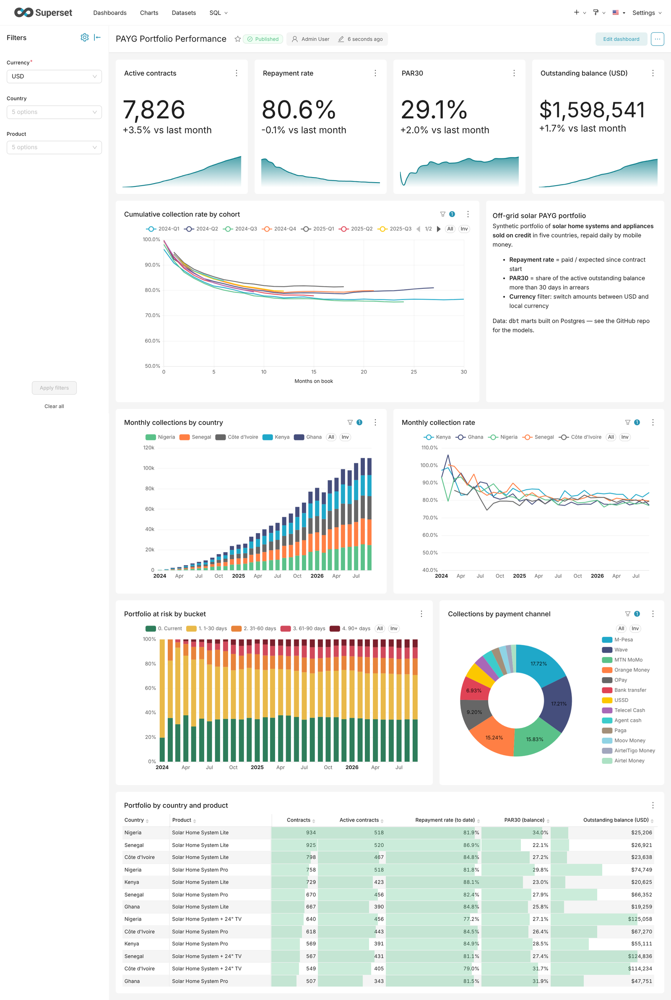
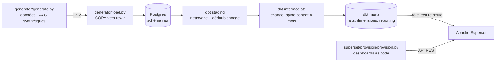

# Solar PAYG Analytics — dbt + Apache Superset

*[English version](README.md)*

Une stack analytique complète pour une entreprise de **solaire hors réseau en Pay-As-You-Go
(PAYG)** : kits solaires et équipements vendus à crédit dans cinq pays africains, remboursés
par petits paiements quotidiens via mobile money.

Une seule commande construit tout : données synthétiques → Postgres → modèles et tests
**dbt** → dashboard **Apache Superset**, provisionné *as code* via l'API REST de Superset.



> Toutes les données sont synthétiques, générées par [`generator/generate.py`](generator/generate.py).
> Aucune donnée réelle d'entreprise ou de client n'est utilisée.

## Démarrage rapide

Prérequis : Docker avec Compose v2.

```bash
git clone https://github.com/ibra6c/solar-payg-analytics.git
cd solar-payg-analytics
cp .env.example .env          # puis définir SUPERSET_SECRET_KEY (openssl rand -base64 42)
docker compose up -d --build  # ou : make up
```

Après 2 à 3 minutes, ouvrir **http://localhost:8088** (admin / admin) →
*Dashboards* → **PAYG Portfolio Performance**.

## Architecture



## Le problème métier

Le client PAYG paie un **acompte**, repart avec l'équipement, puis achète des **jours de
crédit** par mobile money (Wave, Orange Money, M-Pesa, MTN MoMo…). Quand le crédit est épuisé,
l'appareil se verrouille jusqu'à la recharge suivante. Une fois le prix payé, il en devient propriétaire.

| KPI | Définition (telle qu'implémentée) |
|---|---|
| **Taux de remboursement** | Payé à date ÷ attendu à date ; attendu = acompte + tarif journalier × jours écoulés (plafonné au prix total) |
| **Courbe de collecte cumulée** | Le même ratio par **cohorte** (trimestre de vente) et **mois d'ancienneté** |
| **PAR30** | Part de l'encours *actif* en retard de plus de 30 jours |
| **Jours de retard** | (Attendu − payé) ÷ tarif journalier |
| **Statut du contrat** | `Paid off` · `Written off` (> 120 jours de retard, paramétrable) · `Active` |

## Choix de conception

1. **Un sélecteur de devise sans « field parameters » Power BI.** Les modèles de reporting sont
   en format *long* : chaque ligne existe en `currency_view = 'USD'` et en `'Local'`. Un filtre
   natif obligatoire à sélection unique sur `currency_view` (USD par défaut) devient le sélecteur.
2. **Dashboards as code, idempotents.** [`provision.py`](superset/provision/provision.py)
   déclare la couche sémantique (métriques SQL et formats), les graphiques, la mise en page,
   les filtres natifs et les couleurs des tranches PAR. Avec `--verify`, chaque requête de
   graphique est exécutée via l'API — la CI le fait contre un vrai Superset.
3. **Les métriques vivent dans la couche sémantique**, définies une seule fois ; les ratios
   sont calculés en `SUM(numérateur) / SUM(dénominateur)`, jamais en moyenne de ratios.
4. **Moindre privilège.** Superset se connecte avec un rôle `superset_reader` qui ne peut que
   lire le schéma `marts` (droits gérés par dbt).
5. **Des courbes de cohortes honnêtes** : une cohorte n'est tracée que jusqu'à l'âge atteint
   par son dernier mois de vente (`is_complete_period`).
6. **Des problèmes de données réalistes** : ~0,4 % d'événements de paiement dupliqués
   (dédoublonnés en staging), choc de dévaluation dans la série de change du Nigeria.

**25 tests dbt** : clés, relations, valeurs acceptées, et tests métier — un client ne paie
jamais plus que le prix, le cumul payé ne baisse jamais, et **rapprochement** entre le
snapshot mensuel et la table des paiements.

## CI

[GitHub Actions](.github/workflows/ci.yml) à chaque push : lint (ruff), `dbt build` sur un
portefeuille de 3 000 contrats, puis test de bout en bout avec Superset 6.0.

## Licence

[MIT](LICENSE)
