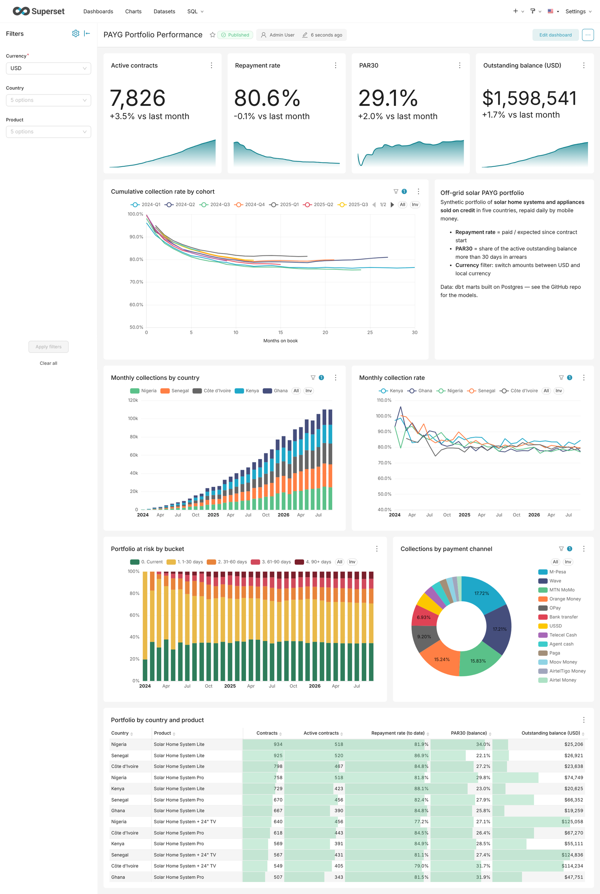
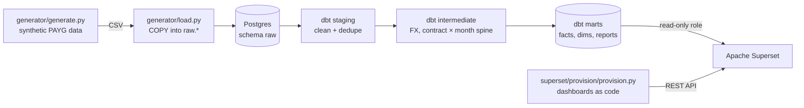

# Solar PAYG Analytics — dbt + Apache Superset

[](https://github.com/ibra6c/solar-payg-analytics/actions/workflows/ci.yml)


*[Version française](README.fr.md)*

An end-to-end analytics stack for an **off-grid solar Pay-As-You-Go (PAYG)** business:
solar home systems and appliances sold on credit in five African countries and repaid
in small daily instalments through mobile money.

One command builds everything: synthetic data → Postgres → **dbt** models and tests →
**Apache Superset** dashboard, provisioned *as code* through the Superset REST API.



> All data is synthetic and generated by [`generator/generate.py`](generator/generate.py).
> No real company or customer data is used.

---

## Quick start

Requirements: Docker with Compose v2.

```bash
git clone https://github.com/ibra6c/solar-payg-analytics.git
cd solar-payg-analytics
cp .env.example .env          # then set SUPERSET_SECRET_KEY (openssl rand -base64 42)
docker compose up -d --build  # or: make up
```

After 2–3 minutes, open **http://localhost:8088** (admin / admin) →
*Dashboards* → **PAYG Portfolio Performance**.

Follow the build with `docker compose logs -f pipeline superset-provision`.

| Command | What it does |
|---|---|
| `make up` | Start the whole stack |
| `make pipeline` | Regenerate the data and rebuild the dbt models |
| `make provision` | Re-apply the dashboard definition (idempotent) |
| `make reset` | Delete all volumes and start over |

---

## Architecture



| Service | Role |
|---|---|
| `postgres` | One instance, two databases: `warehouse` (analytics) and `superset` (metadata) |
| `pipeline` | One-shot job: generate data → load `raw` → `dbt build` (models + tests) |
| `superset` | Superset 6.0 web app |
| `superset-provision` | One-shot job: creates database connection, datasets, metrics, charts and dashboard, then runs every chart query to check it |

---

## The business problem

A PAYG customer pays a **deposit**, takes the device home, then buys **days of
credit** with mobile money (Wave, Orange Money, M-Pesa, MTN MoMo…). When credit runs out the
device locks until the next top-up. After the full price is paid, the customer owns the device.

The questions a credit / operations team asks every month:

| KPI | Definition (as implemented) |
|---|---|
| **Repayment rate** | Paid to date ÷ expected to date, where expected = deposit + daily rate × days on book (capped at the full price) |
| **Cumulative collection curve** | The same ratio by **cohort** (sales quarter) and **months on book** — the standard way to compare vintages |
| **PAR30** | Share of the *active* outstanding balance more than 30 days in arrears |
| **Days in arrears** | (Expected − paid) ÷ daily rate |
| **Contract status** | `Paid off` · `Written off` (> 120 days in arrears, configurable) · `Active` |

## Data model (dbt)

```
raw (loaded by the generator)
└── staging        views — renaming, typing, deduplication
    ├── stg_payments            at-least-once feed → 1 row per provider_reference
    ├── stg_contracts           cohort month/quarter, total price
    └── stg_fx_rates, stg_products, stg_customers, stg_agents, stg_countries
└── intermediate   views
    ├── int_payments_usd        payments converted at the monthly FX rate
    └── int_contract_months     contract × month spine: expected vs paid, local + USD
└── marts          tables (granted to the read-only BI role)
    ├── dim_contracts           denormalised contract dimension
    ├── fct_payments            1 row per payment
    ├── fct_contract_monthly    month-end snapshot: arrears, PAR bucket, status, outstanding
    └── reporting/
        ├── rpt_cumulative_collections   cohort curves, in USD and local currency
        └── rpt_collections_monthly      collections vs billing by country/product/channel
```

**25 data tests**: uniqueness and not-null keys, relationships, accepted values, plus
business tests in [`dbt/tests/`](dbt/tests):
- a customer can never pay more than the device price;
- cumulative paid never decreases;
- **reconciliation**: total collections in the monthly snapshot = total of deduplicated payments
  (catches fan-out joins and dropped rows).

---

## Design decisions worth reading

**1. A currency toggle without Power BI field parameters.**
Power BI dashboards often switch between USD and local currency with a field parameter or a DAX
`SWITCH`. Superset has no equivalent on dashboards, so the reporting models are written in a
*long* format: every row exists once with `currency_view = 'USD'` and once with `'Local'`.
A required single-select **native filter** on `currency_view` (default `USD`) then becomes the
toggle — no Jinja, no duplicated charts, and it works in Explore and SQL Lab too.

**2. Dashboards as code, idempotent.**
[`provision.py`](superset/provision/provision.py) declares the semantic layer (metrics with
their SQL and formats), the charts, the grid layout, the native filters and fixed colours for
PAR buckets. Objects are matched by name and updated, so it can run at every deploy. With
`--verify` it executes every chart query through `/api/v1/chart/data` and fails if one breaks
or returns nothing — the CI does exactly that against a real Superset.

**3. Metrics live in the semantic layer, not in charts.**
`par30`, `repayment_rate`, `collection_rate`… are defined once on the datasets. Ratios are
computed as `SUM(numerator) / SUM(denominator)`, never as an average of row-level ratios.

**4. Least privilege.**
Superset connects with a `superset_reader` role that can only `SELECT` from the `marts` schema
(granted by dbt `grants` + an `on-run-end` hook). It cannot see `raw`, `staging` or write anything.

**5. Honest cohort curves.**
A cohort quarter is only plotted up to the age its *last* sales month has reached
(`is_complete_period`); otherwise the tail of each curve reflects only the first weeks of the
quarter and drops misleadingly.

**6. Realistic data problems, handled in staging.**
The payment feed contains ~0.4 % duplicated webhook events; `stg_payments` deduplicates on the
provider reference. Nigeria's FX series includes a devaluation shock, which makes the USD vs
local-currency views tell different stories.

---

## Running without Docker

```bash
python -m venv .venv && source .venv/bin/activate
pip install -r requirements.txt

# Postgres must be running, with a `warehouse` database and a `superset_reader` role
export WAREHOUSE_HOST=localhost WAREHOUSE_PASSWORD=postgres
bash docker/pipeline/run.sh

# Superset (Python 3.11)
pip install -r requirements-superset.txt
# see the e2e job in .github/workflows/ci.yml for the exact commands
```

## CI

[GitHub Actions](.github/workflows/ci.yml) runs on every push:
1. **lint** — ruff on the Python code;
2. **dbt** — generates a 3 000-contract portfolio, loads it, runs `dbt build`;
3. **e2e** — same, then starts Superset 6.0, provisions the dashboard and runs every chart query.

## Project structure

```
├── generator/            synthetic data generator + Postgres loader
├── dbt/                  dbt project (models, macros, tests)
├── superset/
│   ├── superset_config.py
│   └── provision/        dashboards as code (REST API)
├── docker/               Dockerfiles and entrypoints
├── docker-compose.yml
└── .github/workflows/    CI
```

## Roadmap

- [ ] Agent performance dashboard (sales, early default rate by agent)
- [ ] Row-level security per country for country managers
- [ ] Alerts & reports: weekly PAR30 email
- [ ] Incremental dbt models for the payment fact

## Author

Built by [@ibra6c](https://github.com/ibra6c) — data & analytics engineer (dbt, SQL, BI) based in Dakar.

## License

[MIT](LICENSE)
